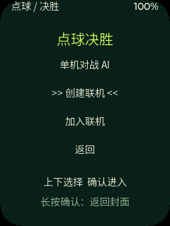
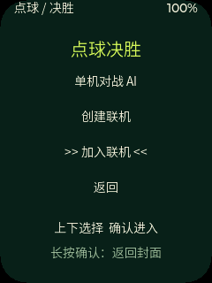

<p align="right">
  <a href="README.zh_CN.md">简体中文</a> · <strong>English</strong>
</p>

# Penalty v2.0.0 — Multiplayer Public Beta

A portrait, three-button penalty game for [FoloToy AI Passport](https://github.com/folotoy/ai-passport). Challenge AI, practise shooting or keeping, or play with a friend on a nearby second device. No Internet connection is required.

## Download

Get the [v2.0.0 Pre-release](https://github.com/yishan/penalty/releases/tag/v2.0.0). Selected two-device checks passed; endurance and the full exception matrix remain incomplete. [v1.4.2](https://github.com/yishan/penalty/releases/tag/v1.4.2) remains available.

| Asset | Purpose |
| --- | --- |
| `FoloToy-AI-Passport-Penalty-v2.0.0-full.bin` | Standalone image at `0x0`; 1,638,400 bytes |
| `FoloToy-AI-Passport-Penalty-v2.0.0-app.bin` | App-only update into a verified compatible app partition; 1,572,864 bytes |
| `SHA256SUMS.txt` | Download integrity checks |
| Three PNGs | Actual UI desktop captures, not device photographs |

**The full image replaces the bootloader/partition layout and may reset settings or make prior apps/resources inaccessible. Do not use it to update a Launcher slot. Never write the app-only file at `0x0`.** Inspect the actual device layout and back up data that must be retained. Launcher slot/rollback/return behavior is not device-verified for this release.

Download the files and `SHA256SUMS.txt`, then run `shasum -a 256 -c SHA256SUMS.txt`. Automatic source archives are not flashable firmware.

## How to play

Keep the device upright. Press OK on the cover. UP/DOWN select menu items with wraparound; OK confirms. Hold OK to return to the cover.

- **Shootout:** challenge AI or use Create Lobby / Join Lobby. One kick each makes a round. Five regular rounds, early finish when a comeback is impossible, paired sudden death on a tie.
- **Shoot Practice:** select a target, press OK to start the meter, then press OK to shoot. Five attempts.
- **Keeper Practice:** read the AI shooter's opening pose, choose a dive and time the save. Five attempts.
- **Settings:** difficulty, sound and English/Simplified Chinese. Only language persists across restarts.

DOWN cycles `top-center → bottom-center → top-left → bottom-left → top-right → bottom-right`; UP reverses it. The first OK locks the target and starts the meter; the next stops it to kick or dive.

### Nearby multiplayer

1. Open Shootout on both devices. Choose Create Lobby on one, Join Lobby and the matching four-digit lobby code on the other.
2. Compare the six-digit security values and confirm only if they match. Confirm the creator's chosen difficulty.
3. The creator presses OK to toss the coin. Creating or joining does not decide who shoots first.
4. Both people choose independently without opponent direction cues. The creator wears red, the joiner blue, and the keeper black on both screens.
5. Keep both devices powered after a disconnect. Recovery within 30 seconds retains locked choices and scores without another toss or duplicate settlement. Timeout ends without a winner; device restart does not restore the match.




## Changes and validation

v2 adds nearby multiplayer, consistent jerseys and paired-round counters, clearer menu spacing and selection markers, revised cover text, balanced character sizes and lossless footprint reductions. See [release notes](penalty/docs/releases/v2.0.0.md).

- Build: PASS — ESP-IDF 5.5.3 full gate and verified firmware archive.
- Host tests: PASS — rules/protocol/recovery, bilingual actual-LVGL rendering and 50-cycle UI lifecycle checks.
- Device tests: PASS only for this exact normal v2.0.0 app's installation, independent Flash verification and bounded startup. Earlier development builds received selected two-device gameplay/recovery checks.
- Unverified: normal-release gameplay, endurance, full disconnect/security/compatibility matrix, multiple lobbies, resource/timing/power measurements and Launcher acceptance. See [evidence](penalty/docs/validation.md).

GitHub distribution is separate from the official FoloToy community; this version has not been submitted there.

## Build the open-source layer

This is a generated application-layer export, **not a standalone ESP-IDF project**. [MANIFEST.md](MANIFEST.md) records the source commit, exact baseline, exported paths and licenses. Development stays in the authoritative Penalty worktree; reconcile public-repository changes there before another export.

```bash
git clone https://github.com/folotoy/ai-passport.git
cd ai-passport
git checkout ccd3576e304f7e17d9a0d4c12a2d05db379b14c0
/path/to/penalty/apply.sh --dry-run .
/path/to/penalty/apply.sh .
source /path/to/esp-idf-v5.5.3/export.sh
HOST_PYTHON=/path/to/python-with-pillow ./tools/validate.sh
```

Review the dry run and target edits before applying: listed paths are overwritten. The script checks the baseline and copies only `export-files.txt`. Normal builds disable development fault hooks; do not distribute `--dev-ble-faults` builds. Rebuild timestamps/paths/ELF hashes may differ; Release checksums identify the distributed binary.

## License

MIT, retaining FoloToy and Yishan notices in [LICENSE](LICENSE). Source Han Sans SC subsets retain the bundled SIL Open Font License; synthesized audio is CC0. Original AI-generated artwork provenance is in [assets/README.md](assets/README.md).
